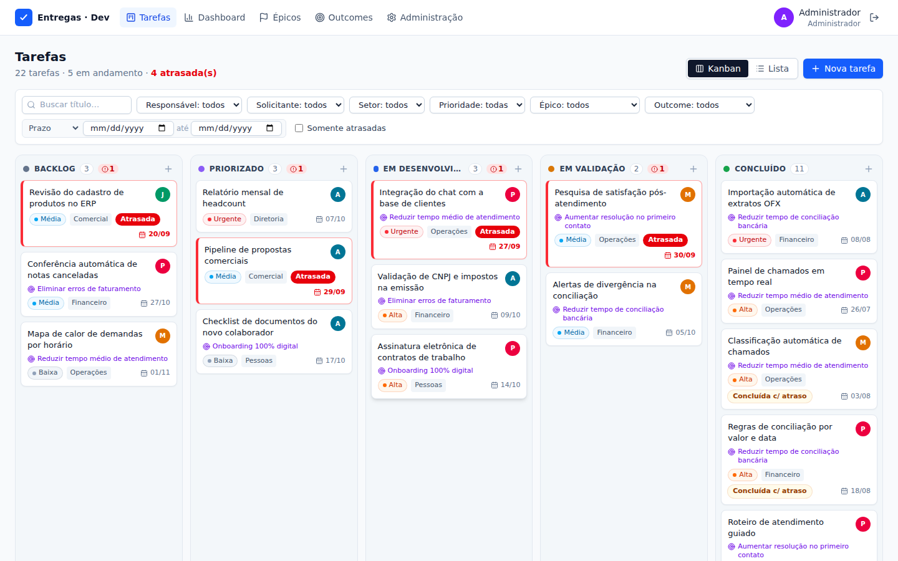

# Gestão de Melhorias — Solução RC+

Sistema web interno (MVP) para acompanhar as entregas da área de Desenvolvimento:
**Épico → Outcome → Tarefas**, Kanban, lista, indicadores de fluxo e indicadores de negócio.



## Funcionalidades

- **Tarefas** em Kanban (arrastar-e-soltar entre status) ou Lista (ordenável), com filtros combináveis:
  status, responsável, solicitante, setor, prioridade, épico, outcome, período e "somente atrasadas".
- **Regras automáticas**: data de criação, início real e conclusão real preenchidos pelas mudanças
  de status (baseadas em flags configuráveis, não no nome), indicação de atraso e histórico completo.
- **Épicos** (ligados a um OKR) e **Outcomes** com indicador de negócio (baseline → atual → meta).
  Cada outcome tem uma **cor** (escolhida automaticamente ou no cadastro) que aparece como tag nas
  tarefas — cards do Kanban, lista e detalhe.
- **Comentários nas tarefas**: texto com links clicáveis e até 5 anexos por comentário (10 MB no
  total) — imagens (inclusive prints colados com Ctrl+V), PDF, Word, Excel, PowerPoint, CSV, TXT e vídeos. Quem escreveu edita e exclui; o administrador exclui qualquer um.
- **Ordem do quadro**: no Kanban, arraste os cards para definir a ordem dentro de cada coluna (o PO
  prioriza e quem executa puxa o primeiro). Também dá para ordenar por prioridade e prazo, conclusão
  prevista ou data de criação.
- **Épicos e outcomes também em Kanban ou Lista**, com as mesmas colunas (status) das tarefas:
  arraste para mudar de coluna ou priorizar dentro dela; na lista, clique no cabeçalho para ordenar.
- **Priorização ICE** nos outcomes: Impacto, Confiança e Facilidade (1–10) e ICE score calculado
  automaticamente (impacto × confiança × facilidade), com ordenação por qualquer um deles.
- **Dashboard**: Cycle Time, Lead Time, Throughput, tarefas criadas, WIP, atrasadas e Aging, com
  filtros por período, responsável, setor, épico e outcome.
- **Administração** (somente administradores): usuários, setores e status (ordem, cor, padrão, início,
  conclusão, WIP, encerra sem entrega, ativo).
- **Solicitações de melhoria**: qualquer pessoa envia uma ideia (nome, descrição, benefício, indicador
  de sucesso, setor, link e até 5 anexos somando 10 MB). O administrador analisa em **Aprovações**:
  pede mais informação (volta para o solicitante complementar), recusa com motivo ou aprova
  convertendo em **Tarefa, Outcome ou Épico** com o formulário já preenchido. O item gerado mostra a
  solicitação de origem e os anexos; o solicitante acompanha o andamento em "Minhas solicitações".
- **Horizontes (H1, H2, H3)** em épicos e outcomes (modelo dos 3 horizontes): selo nos cards, listas
  e detalhes; filtro nas telas de épicos, outcomes e tarefas e no dashboard. A tarefa herda o horizonte
  do outcome (ou do épico, se não tiver outcome); o outcome novo sugere o horizonte do épico.
- **Tags nas tarefas** (ex.: o fornecedor "Kynera"): digite no cadastro da tarefa (sugere as existentes);
  aparecem no quadro e na lista, filtram tarefas e o dashboard, que tem o gráfico **Tarefas por tag**.
  Renomear, trocar a cor ou excluir: Administração → Tags.
- **Flag (bloqueio)** em tarefas e outcomes: marca que o item depende de algo externo (ex.: o negócio
  liberar um acesso ou enviar um documento), com motivo. Colocar e retirar ficam no histórico; o
  quadro e a lista mostram o selo, a lista de tarefas filtra "Somente com flag" e o dashboard mostra o
  **tempo médio com flag**.
- **Conector do Claude (MCP)** em `/mcp`: o Claude lê, busca (evita duplicados), cria e edita épicos,
  outcomes e tarefas, pedindo aprovação antes de gravar. Tokens em Administração → Integrações.
  Passo a passo: [docs/CONECTOR-CLAUDE.md](docs/CONECTOR-CLAUDE.md).
- **Lixeira**: tarefas, outcomes e épicos excluídos ficam 30 dias e podem ser restauradas por qualquer usuário da equipe;
  depois são removidas automaticamente. Mover para a lixeira, esvaziar e excluir definitivamente:
  somente administradores.
- **Perfis**:

  | Perfil | Pode |
  |---|---|
  | Administrador | Tudo: aprovações, lixeira, usuários, setores e status |
  | Usuário (equipe) | Criar/editar tarefas, outcomes e épicos (sem precisar de solicitação), colocar/retirar flags, enviar solicitações, restaurar da lixeira. Não exclui itens |
  | Solicitante | Apenas enviar e acompanhar as próprias solicitações |

Visual: segue o design system **RC+ apps** (monocromático: preto RC+ como cor de ação sobre o papel RC+,
Public Sans, menu lateral e cartões brancos com sombra leve). Os tokens ficam em `client/src/index.css`.
O login usa o fundo ilustrado "Gestão de Melhorias · B — Ciclo de melhoria" (`client/public/login-melhorias.svg`).

Detalhes de arquitetura, modelo de dados, regras e fórmulas: **[docs/ARQUITETURA.md](docs/ARQUITETURA.md)**.

## Como rodar localmente

Requisitos: **Node.js 22.13+** (recomendado: versão LTS atual). Nada mais: o banco usa o SQLite
embutido no Node, então o `npm install` não precisa compilar nada (nem Python, nem Visual Studio).

No Windows, use o **Prompt de Comando (cmd)** — o PowerShell pode bloquear o `npm`.

```bash
npm install        # instala server e client (workspaces)
npm run seed       # cria data/app.db com dados de demonstração (apaga o banco existente!)
npm run dev        # API em :3001 e frontend em http://localhost:5173
```

Acessos de demonstração:

| Usuário | E-mail | Senha | Perfil |
|---|---|---|---|
| Administrador | admin@empresa.com | admin123 | Administrador |
| João | joao@empresa.com | 123456 | Administrador |
| Maria, Pedro, Ana | maria@ / pedro@ / ana@empresa.com | 123456 | Usuário |
| Carla | carla@empresa.com | 123456 | Solicitante (setor Comercial) |

## Importar a planilha de demandas (CSV)

Com o sistema **desligado**, na pasta do projeto:

```bash
npm run importar -- caminho\planilha.csv --simular   # mostra o que seria importado, sem gravar
npm run importar -- caminho\planilha.csv             # importa de fato
```

- Antes de gravar, é feita uma cópia de segurança do banco em `data/backups/`.
- Pode ser executado de novo sem duplicar: tarefas com o mesmo título são ignoradas.
- Aceita o CSV exportado pelo Excel (Windows-1252 ou UTF-8; vírgula ou ponto e vírgula; datas
  mês/dia/ano ou dia/mês/ano, detectadas automaticamente).
- Regras de conversão (status, setores, títulos, observações etc.) documentadas no início de
  `server/src/db/import-csv.ts`.

## Publicar na web (teste)

Passo a passo para publicar no Fly.io, com endereço `https://<nome>.fly.dev`, HTTPS e disco
permanente: **[docs/PUBLICAR-FLY.md](docs/PUBLICAR-FLY.md)**.

## Produção

```bash
npm install
npm run build                  # compila frontend e backend
NODE_ENV=production npm start  # um único processo: http://localhost:3001
```

Em um banco vazio (sem seed), a primeira execução cria o administrador (`ADMIN_EMAIL` /
`ADMIN_PASSWORD`, padrão `admin@empresa.com` / `admin123`) e o fluxo de status padrão.
Troque a senha em **Administração → Usuários**.

Variáveis de ambiente (todas opcionais):

| Variável | Padrão | Descrição |
|---|---|---|
| `PORT` | `3001` | Porta HTTP |
| `DB_PATH` | `data/app.db` | Arquivo SQLite (backup = copiar o arquivo) |
| `UPLOADS_DIR` | `data/uploads` | Anexos das solicitações (inclua no backup junto com o banco; em servidor, use disco persistente) |
| `APP_TIMEZONE` | `America/Sao_Paulo` | Fuso de negócio para datas, atrasos e períodos |
| `SESSION_DAYS` | `7` | Validade da sessão |
| `TRASH_DAYS` | `30` | Dias que um item excluído (tarefa, outcome, épico) fica na lixeira antes da remoção definitiva |
| `ADMIN_EMAIL`, `ADMIN_PASSWORD` | — | Administrador inicial em banco vazio |
| `COOKIE_SECURE` | `false` | Use `true` ao servir via HTTPS |
| `TRUST_PROXY` | `false` | Use `true` atrás de um proxy (Fly.io, Railway, Nginx) |
| `BACKUP_DIR` | `backups/` ao lado do banco | Pasta das cópias diárias do banco |
| `BACKUP_KEEP` | `7` | Quantas cópias diárias manter |

## Testes

```bash
npm test           # regras de negócio, fuso horário, métricas e API (Vitest)
npm run typecheck  # TypeScript do backend e frontend
```

## Estrutura

```
server/
  src/config.ts               configuração central (porta, banco, fuso)
  src/db/                     conexão, migrations, bootstrap e seed
  src/lib/                    auth, datas/fuso, validação, erros HTTP
  src/modules/                um módulo por entidade
    tasks/rules.ts            regras puras de status e atraso
    tasks/service.ts          criação, edição, mudança de status, histórico, filtros
    dashboard/metrics.ts      cálculo puro dos indicadores
  tests/                      testes de regras e de API
client/
  src/pages/                  Tarefas, Dashboard, Épicos, Outcomes, Administração, Login
  src/components/             Kanban, lista, filtros, modal de tarefa, componentes de UI
  src/lib/                    cliente da API, autenticação, formatação (fuso), queries
docs/ARQUITETURA.md           arquitetura, modelo de dados, regras e fórmulas
```
